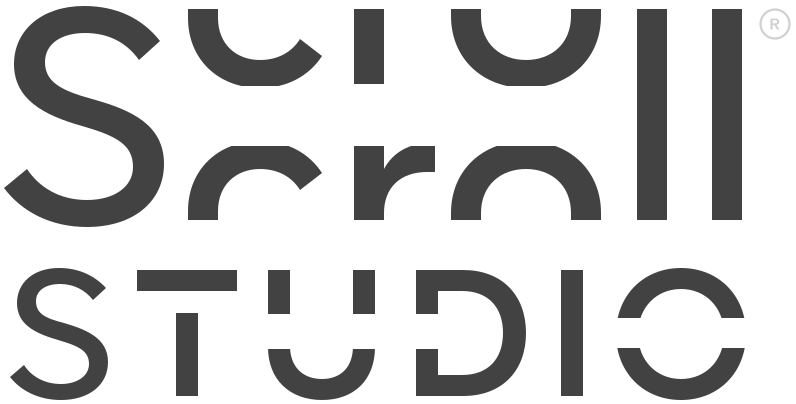
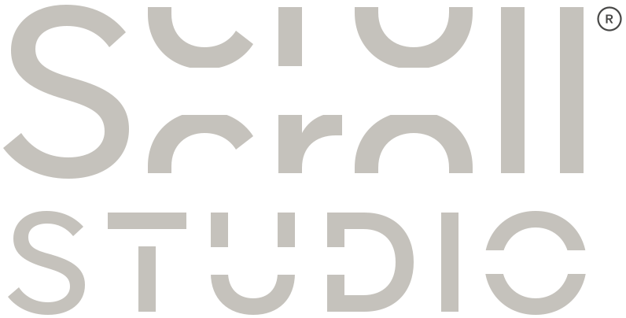

# Tema scuro in un'app che usa già il kit (kit 1.0 → 1.1)

Per un'app già ridisegnata con il kit (oggi TopFratmRanks). Alla fine l'app ha lo switch del tema nella topbar, segue il tema scelto nell'hub e, **finché nessuno sceglie lo scuro, è identica a prima**: i token nuovi valgono in chiaro esattamente quello che oggi è scritto a mano.

Prima leggi `CHANGELOG.md` (cosa cambia nel kit 1.1) e la sezione "Temi" di `FAMILY-DESIGN.md` (contratto e regole).

## 0. Prima di iniziare

- `git status` pulito, poi un branch dedicato: `git switch -c feature/dark-theme`.
- Quale kit ha l'app: `grep -m1 "kit " css/tokens.css`. Nessun risultato = kit 1.0.
- Il kit sta in `D:/PROGETTI/ScrollStudio/ScrollStudio/design-kit` (nel seguito `$KIT`).

## 1. File da copiare

| Da `$KIT` | Nell'app (es. TopFratmRanks) | Come |
|---|---|---|
| `tokens.css` | `css/tokens.css` | si sostituisce, poi si rimette **in coda** il blocco "<App> additions" del file vecchio |
| `family.css` | `css/family.css` | come sopra |
| `theme.js` | `js/theme.js` (accanto a `i18n.js`) | nuovo |
| `assets/scrollstudio-wordmark-light.svg` | `assets/` (accanto a `scrollstudio-wordmark.svg`) | nuovo |
| `i18n.js` | | non cambia nel kit 1.1: non serve ricopiarlo |

Le aggiunte dell'app iniziano con la riga `/* ====…` subito sopra il commento "<App> additions". Da dentro la cartella dell'app:

```bash
KIT="D:/PROGETTI/ScrollStudio/ScrollStudio/design-kit"
for f in tokens.css family.css; do n=$(grep -n "additions" "css/$f" | head -1 | cut -d: -f1); tail -n +$((n - 1)) "css/$f" > "/tmp/$f.app"; { cat "$KIT/$f"; echo; cat "/tmp/$f.app"; } > "css/$f"; done
cp "$KIT/theme.js" js/theme.js && cp "$KIT/assets/scrollstudio-wordmark-light.svg" assets/
```

Controllo: la parte del kit dev'essere identica al kit, le aggiunte identiche a prima.

```bash
for f in tokens.css family.css; do diff <(head -n "$(wc -l < "$KIT/$f")" "css/$f") "$KIT/$f" > /dev/null && echo "$f: kit ok"; done
```

## 2. HTML, in ogni pagina

**`<head>`**: `theme.js` sincrono (niente `defer`, `async` o `type="module"`), **dopo** `<meta name="theme-color">` e **prima** del primo `<link rel="stylesheet">`. Così `data-theme` c'è già quando arrivano i CSS e la pagina non lampeggia chiara.

```html
  <meta name="theme-color" content="#E9E9E8">
  <script src="js/theme.js"></script>
  <link rel="stylesheet" href="css/tokens.css">
```

`<meta name="theme-color">` resta com'è (`#E9E9E8`): lo aggiorna `theme.js` con `--wall-top` del tema attivo.

**Switch del tema**: subito dopo il `div.ss-lang` della topbar.

```html
    <div class="ss-theme" role="group" aria-label="Tema" data-en-aria-label="Theme">
      <button class="ss-theme__option" type="button" aria-pressed="true" data-theme-choice="light" aria-label="Tema chiaro" data-en-aria-label="Light theme">
        <svg class="ss-icon" viewBox="0 0 12 12" aria-hidden="true"><circle cx="6" cy="6" r="2.2"/><path d="M6 1v1.2M6 9.8V11M1 6h1.2M9.8 6H11M2.5 2.5l.85.85M8.65 8.65l.85.85M2.5 9.5l.85-.85M8.65 3.35l.85-.85"/></svg>
      </button>
      <button class="ss-theme__option" type="button" aria-pressed="false" data-theme-choice="dark" aria-label="Tema scuro" data-en-aria-label="Dark theme">
        <svg class="ss-icon" viewBox="0 0 12 12" aria-hidden="true"><path d="M9.5 7.6A4 4 0 1 1 4.4 2.5a4.2 4.2 0 0 0 5.1 5.1Z"/></svg>
      </button>
    </div>
```

L'`aria-pressed` scritto nell'HTML è solo il punto di partenza: `theme.js` lo corregge appena la pagina è letta. I testi IT/EN degli `aria-label` li traduce `i18n.js`, come per lo switch lingua.

**Wordmark**: è un `` grigio scuro e al buio sparirebbe; non può prendere `currentColor`. Si mettono due ``, uno per tema, nella topbar e nel footer. Quello nascosto ha `display: none`, quindi esce anche dall'albero dell'accessibilità. Topbar:

```html
    <a class="ss-topbar__home" href="https://kekkocoppola.github.io/ScrollStudio/" aria-label="ScrollStudio, torna all'hub" data-en-aria-label="ScrollStudio, back to the hub">
      
      
    </a>
```

Footer:

```html
  <footer class="ss-footer">
    
    
    <span>© 2026</span>
  </footer>
```

Si scaricano tutti e due (circa 4 KB l'uno): è il prezzo per non far comparire il logo in ritardo quando si cambia tema.

## 3. Dove va lo switch nella topbar

| Topbar | Desktop | Telefono (≤ 640px) |
|---|---|---|
| con nav | subito dopo `.ss-lang`, a destra | il kit lo mette in fondo alla seconda riga, a destra della nav: nessuna regola da aggiungere |
| senza nav (TopFratmRanks, regola N15) | subito dopo `.ss-lang`: il `margin-left: auto` della N15 spinge a destra lingua **e** tema insieme, nessuna regola da aggiungere | il kit lo mette da solo sulla seconda riga, a destra; la N15 va aggiornata (sotto) |

Perché su telefono non sta nella prima riga: a 375px restano 327px fra i margini; wordmark (59) + barra + avatar e nome del prodotto + switch lingua (77) occupano già circa 320px con "TopFratmRanks" e circa 290px con "Bouncical", spazi da 16px compresi. Lo switch tema chiede altri 72px.

Topbar senza nav, su telefono: la N15 aggiungeva `padding-bottom: var(--s-6)` (32px) perché la seconda riga era vuota. Ora la seconda riga c'è (lo switch, alto 28px): si toglie il padding e si stringe lo spazio fra le righe a 4px, così 4 + 28 = 32 e il titolo della pagina resta esattamente dov'era. Nel blocco "<App> additions" di `family.css`, al posto della regola N15 per telefono:

```css
/* On phones the theme switch is the second row (kit 1.1): 4px row gap + the 28px switch
   give the same 32px of air the empty row used to need, so the page title doesn't move */
@media (max-width: 640px) {
  .ss-topbar:not(:has(.ss-topbar__nav)) {
    row-gap: var(--s-1);
  }
}
```

## 4. Colori scritti a mano nelle aggiunte dell'app

Il kit è già a posto. Restano da controllare le aggiunte dell'app (in coda a `tokens.css` e `family.css`), gli altri CSS dell'app, gli `style="…"` nell'HTML e i colori impostati dal JS.

```bash
n=$(grep -n "additions" css/family.css | head -1 | cut -d: -f1); tail -n +$n css/family.css | grep -nE "#[0-9a-fA-F]{3,8}|rgb\(|%23"
grep -nE "#[0-9a-fA-F]{3,8}|rgb\(|%23" css/style.css
grep -nE "style=\"[^\"]*(#[0-9a-fA-F]{3,8}|rgb\()" *.html
grep -nE "#[0-9a-fA-F]{3,8}|rgb\(" js/*.js
```

Per ogni risultato:

1. **È contenuto?** (canvas, video esportato, colori dell'utente e i loro default, bandiere, loghi) → resta com'è, si scrive nel report.
2. **È un'ombra `rgb(var(--shadow-ink) / α)`?** → resta: segue `--shadow-ink`, che al buio diventa nero.
3. **È interfaccia** → si cerca il token che fa quel mestiere (tabella "Token di ruolo" di `FAMILY-DESIGN.md`). Attenzione ai token che fanno due mestieri: `--paper` usato come **testo** su un fondo `--ink-900` diventa `--on-ink`, non `--paper`.
4. **Nessun token adatto** → token di ruolo nuovo, nelle "<App> additions" di `tokens.css`, con il valore chiaro uguale a quello di oggi e il valore scuro in un blocco suo:

   ```css
   :root {
     --rank-ring: rgb(var(--shadow-ink) / 0.2);     /* esempio: valore chiaro = quello scritto oggi */
   }

   :root[data-theme="dark"] {
     --rank-ring: rgb(236 234 230 / 0.2);           /* stessa opacità, sull'inchiostro chiaro */
   }
   ```

   Poi si calcola il contrasto (testo ≥ 4,5:1, comandi ≥ 3:1) in tutti e due i temi e lo si mette nel report.
5. **Icona in data-URI** → l'intero `url("data:…")` diventa un token con un valore per tema (come `--chevron`): `currentColor` dentro `background-image` non funziona.
6. **JS che disegna l'interfaccia** (non il contenuto) con un colore → lo legge da `getComputedStyle(document.documentElement).getPropertyValue('--token')` e ridisegna sull'evento `ss:theme`.

## 5. Cosa resta escluso

Canvas e video esportato, colori scelti dall'utente (e i loro default, es. il bianco delle parole), preset, bandiere dello switch lingua, loghi e avatar dei prodotti, poster e miniature, fondo `--video-ink` dei media. Non si toccano in nessuno dei due temi.

## 6. Controlli (statici)

- Il `grep` del punto 4 trova solo contenuto e ombre su `--shadow-ink`.
- Ogni riga cambiata: il valore chiaro è identico a prima (stesso colore, stessa opacità). Le regole cambiate vanno elencate nel report.
- `diff` del punto 1: la parte del kit è identica al kit.
- Contrasti dei token nuovi o usati in modo nuovo, calcolati in tutti e due i temi.

---

## Appendice: TopFratmRanks

Riferimenti: `design/KIT-FEEDBACK.md` e il blocco "TopFratmRanks additions" in coda a `css/family.css`.

### Componenti N1–N15

| ID | Componente | In scuro | Cosa cambiare |
|---|---|---|---|
| N1 | `.ss-segmented--grid` | campo `--field` incassato nella carta, numeri in inchiostro chiaro; l'opzione scelta segue la scelta dell'app sui bottoni (sotto) | niente oltre a quella scelta |
| N2 | `.ss-clip--slot` | carta, numero `--ink-900`, chevron `--ink-500`, il `<select>` nativo si apre scuro grazie a `color-scheme`; scheda vuota con un file sopra: `--wall-glow` (8% di bianco sulla carta) + anello `--ink-700` | niente |
| N3 | `.ss-words` / `.ss-word` | la pillola è d'inchiostro (scelta dell'app) e al buio diventa chiara; il pallino ha il colore dell'utente, l'anello lo stacca dalla pillola | anello da `--paper` a `--on-ink` (sotto) |
| N4 | `.ss-swatch-list` | etichette `--ink-700`, swatch con `--swatch-ring` del kit; l'hover `--ink-500` dell'app va bene | niente |
| N6 | `.ss-progress--indeterminate` | traccia `--track`, riempimento `--ink-900` | niente |
| N7 | `.ss-summary` | `dt` `--ink-700`, `dd` `--ink-900` | niente |
| N8 | `.ss-howto` | numeri `--ink-900` | niente |
| N9 | `.ss-link--inline` | testo `--ink-900`, sottolineatura `--track` (1,57:1 sulla carta scura, più visibile che in chiaro) | niente |
| N10 | `.ss-code` | `--field` + `--ink-900` | niente |
| N11 | `.ss-modal--scroll` | nessun colore; la scrollbar diventa scura con `color-scheme` | niente |
| N12 | `.ss-scrollbox` | `--field` + `--ink-700`, titoli `--ink-900`; scrollbar scura | niente |
| N13 | `.ss-account` | avatar del canale (contenuto) con anello `--hairline` | niente |
| N14 | `.ss-check` | vuota: `--field` con anello `--track`; spuntata: fondo `--ink-900` (chiaro) e spunta scritta `%23FBFBFA` (chiara): **sparirebbe** | spunta da `--check-mark` (sotto) |
| N15 | topbar senza nav | vedi punto 3 | regola per telefono (sotto) |
| N15 | hover di `.ss-swatch` e `.ss-switch` | anello `--ink-500`; manopola con `--shadow-raise-hover` (più densa al buio) | niente |
| N15 | `.ss-icon-btn:disabled` | sovrascritto dalla scelta "disattivati leggibili" | niente |
| N15 | timeline senza segmenti, tempo accanto al Play, segmented con icone, `b` nei testi, badge con icona, `[hidden]` | solo token o nessun colore | niente |

### Le due scelte dell'app

1. **Bottoni non corallo in inchiostro.** Fondo `--ink-900`, hover `--ink-700`: al buio diventano pillole chiare, quindi il testo deve diventare scuro. Oggi è `--paper`, che al buio è scura e quindi funzionerebbe per coincidenza; il ruolo però è "testo su inchiostro": si usa `--on-ink`. Contrasto al buio: 10,22:1 a riposo, 6,91:1 in hover. Stesso discorso per l'opzione scelta del segmented.
2. **Disattivati leggibili.** `--field` con testo `--ink-500`: al buio 5,66:1. Niente da cambiare.

### CSS da cambiare nel blocco "TopFratmRanks additions" di `css/family.css`

Testo dei bottoni d'inchiostro e dell'opzione scelta (era `--paper`):

```css
.ss-btn:not(.ss-btn--primary),
.ss-icon-btn:not(.ss-icon-btn--bare):not(.ss-icon-btn--coral) {
  color: var(--on-ink);
  background: var(--ink-900);
  transition:
    transform var(--dur-hover) ease-out,
    box-shadow var(--dur-hover) ease-out,
    background-color var(--dur-hover) ease-out;
}

.ss-segmented__option[aria-pressed="true"] {
  color: var(--on-ink);
  background: var(--ink-900);
}
```

Anello del pallino colore delle parole (`.ss-word::before`): con `--paper` funziona anche al buio (pillola chiara, anello scuro: un pallino bianco resta visibile), ma solo perché oggi `--on-ink` e `--paper` coincidono. Il ruolo è "su inchiostro":

```css
  box-shadow: 0 0 0 1px var(--on-ink); /* ring in the on-ink colour: a dark word colour still shows on the ink chip */
```

Spunta della casella dei termini (il data-URI con `%23FBFBFA` diventa il token):

```css
.ss-check:checked {
  background-color: var(--ink-900);
  background-image: var(--check-mark);
  box-shadow: none;
}
```

N15 su telefono: la regola `padding-bottom: var(--s-6)` si sostituisce con quella del punto 3 (`row-gap: var(--s-1)`).

### Altri casi noti

| Caso | Cosa fare |
|---|---|
| `<meta name="theme-color" content="#E9E9E8">` in `index.html` ed `editor.html` | lasciarlo com'è; `theme.js` va subito dopo, prima di `css/tokens.css` |
| due `` del wordmark (topbar e footer) in tutte e due le pagine | markup del punto 2, con `assets/scrollstudio-wordmark-light.svg` |
| switch del tema nella topbar | markup del punto 2, dopo il `div.ss-lang`, in tutte e due le pagine |
| colori in `js/editor.js` (`'#FFFFFF'`, colore di default delle parole) e `js/renderer.js` (canvas) | contenuto: restano |
| bandiere in `js/terms.js` | contenuto: restano |
| `css/style.css` | nessun colore: niente |

**Switch lingua nella modale dei termini: serve anche quello del tema?** Proposta: **no**. La lingua è lì perché i termini vanno letti nella propria lingua prima di accettarli, e la topbar è coperta dalla modale. Il tema non impedisce di leggere: segue già quello del sistema (o quello scelto nell'hub) e, accettati i termini, lo switch della topbar è raggiungibile. Una seconda fila di icone nella testa della modale sarebbe solo rumore. Se lo vuoi comunque: stesso markup del punto 2 accanto allo switch lingua in `.terms-head`, creato da `terms.js` con `aria-pressed` = `String(choice === window.ssTheme())`; il click lo gestisce già `theme.js` (che salva anche la scelta), quindi, a differenza della lingua, non serve scrivere `localStorage` a mano.

---

## Appendice: Bouncical

Bouncical non è ancora ridisegnato: fa il redesign partendo dal kit 1.1 con `PROMPT.md`, che copia già `theme.js` e mette lo switch nella topbar, quindi ha il tema scuro fin dall'inizio. Basta rispettare "niente colori scritti a mano" e controllare ogni componente nuovo in tutti e due i temi.
